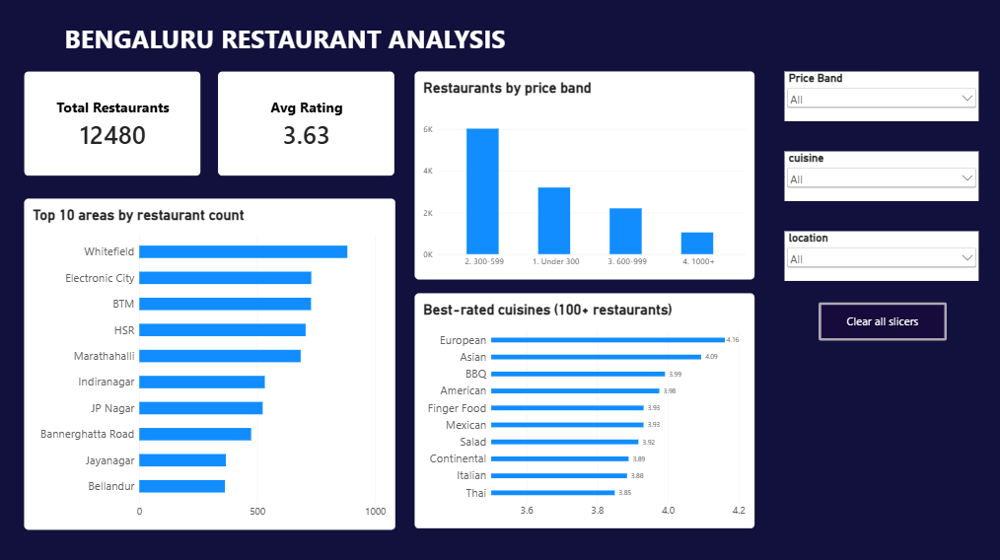

# Bengaluru Restaurant Market Analysis

**Goal:** Find which areas, cuisines and price ranges look most promising for a new restaurant in Bengaluru, and which are oversaturated.

## Dataset
Zomato Bangalore Restaurants (Kaggle), about 51,700 rows, reduced to 12,480 unique restaurants.

## Tools
Python (pandas), SQL (SQLite), Power BI, Gemini API, Streamlit

## What I did
- Cleaned the data: converted ratings and costs to numbers, removed duplicates, handled missing values
- Built a one-row-per-restaurant table and a separate cuisine table
- Wrote SQL queries using joins, CTEs and window functions
- Built an interactive Power BI dashboard with slicers
- Built an AI agent that answers questions in plain English by writing and running SQL

## Key decisions
- Kept unrated ("NEW") restaurants and left their rating empty
- Checked the highest-cost rows: all are luxury hotel restaurants, so no outliers were removed
- Ignored cuisines with fewer than 100 restaurants when ranking ratings, so tiny samples don't skew results

## Findings
- Whitefield has the most restaurants, followed by Electronic City, BTM and HSR
- About half of all restaurants (6,032 of 12,480) are in the Rs 300-599 price band
- Among cuisines with 100+ restaurants, European (4.16) and Asian (4.09) are rated highest

## AskBLR: AI analyst agent
Ask a question in plain English. An LLM (Gemini) writes the SQL, a read-only runner executes it, and the agent explains the result. It retries automatically when its SQL fails.

**Evaluation**
- 16-question test set: 81% on the first run (13/16), 100% after adding column descriptions to the prompt
- 10 unseen questions: 10/10 (see `eval_results_holdout.csv`)
- The first-run failures came from the model using `listing_area` instead of `location`

**Safety:** only SELECT queries run, dangerous keywords are blocked, and the database opens in read-only mode.

## Files
- `bengaluru_restaurants.pbix`: Power BI dashboard
- `bengaluru_restaurants.ipynb`: cleaning and SQL analysis
- `askblr_agent.ipynb`: AI agent and evaluation
- `app.py`, `requirements.txt`: Streamlit app
- `bengaluru_restaurants.db`: SQLite database
- `restaurants_model.csv`, `restaurant_cuisines.csv`: cleaned data
- `eval_results.csv`, `eval_results_holdout.csv`: evaluation results
